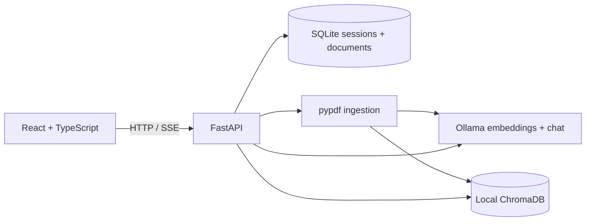
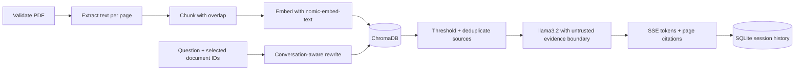

# CiteWeave

**Traceable research across every document.**

CiteWeave is a local-first multi-PDF research assistant that produces evidence-backed answers with page-level citations. PDFs, embeddings, vector data, questions, and conversations remain on your machine; no paid API or cloud account is required.

## Features

- Safe multi-PDF upload with signature/size/count validation, UUID storage, SHA-256 duplicate detection, and per-file results
- Local page extraction, configurable chunking, Ollama embeddings, and persistent Chroma search
- Research across all documents or a checkbox-selected subset
- Streamed Ollama answers with relevance-scored, deduplicated page citations
- Stop, retry, copy, Markdown export, recent conversations, and local SQLite persistence
- Document list, metadata, delete, re-index, and explicitly confirmed clear-all API
- Fast liveness plus bounded SQLite/Chroma/Ollama/model readiness diagnostics
- Responsive, keyboard-friendly research workspace with accessible live status

## Screenshots

Add portfolio screenshots after starting the app locally:

1. Research workspace with indexed documents
2. Streamed answer with expanded page citation
3. System-status drawer showing all local services ready

## Architecture



### RAG pipeline



Blocking PDF, filesystem, embedding, retrieval, and synchronous generation work runs in worker threads instead of the FastAPI event loop. Chroma is the retrieval index; SQLite is the source of truth for document and conversation metadata.

## Technology

React 19, TypeScript, Vite, Tailwind CSS, FastAPI, SQLAlchemy/SQLite, LangChain, ChromaDB, pypdf, Ollama, and optional Docker Compose.

## Native setup — Windows

Prerequisites: Python 3.11 or 3.12, Node.js 20+, and [Ollama](https://ollama.com/).

```powershell
ollama pull llama3.2
ollama pull nomic-embed-text

cd backend
py -3.12 -m venv .venv
.\.venv\Scripts\Activate.ps1
python -m pip install -r requirements-dev.txt
Copy-Item .env.example .env
python -m uvicorn app.main:app --reload --host 127.0.0.1 --port 8000
```

In a second PowerShell window:

```powershell
cd frontend
npm ci
Copy-Item .env.example .env
npm run dev -- --host 127.0.0.1
```

Open <http://127.0.0.1:5173>. API docs are at <http://127.0.0.1:8000/docs>.

## Native setup — Linux/macOS

```bash
ollama pull llama3.2
ollama pull nomic-embed-text
cd backend
python3 -m venv .venv
source .venv/bin/activate
python -m pip install -r requirements-dev.txt
cp .env.example .env
python -m uvicorn app.main:app --reload --host 127.0.0.1 --port 8000
```

In another terminal:

```bash
cd frontend
npm ci
cp .env.example .env
npm run dev -- --host 127.0.0.1
```

## Docker

Keep Ollama running on the host, pull the two models above, then run:

```bash
docker compose up --build
docker compose down
```

The frontend binds to `127.0.0.1:5173`, the API to `127.0.0.1:8000`, and application data persists in `./data`. Chroma is embedded in the API process and is never exposed as a public service.

## Configuration

| Variable | Default | Purpose |
|---|---:|---|
| `OLLAMA_BASE_URL` | `http://localhost:11434` | Ollama endpoint |
| `OLLAMA_CHAT_MODEL` | `llama3.2` | Local chat model |
| `OLLAMA_EMBED_MODEL` | `nomic-embed-text` | Local embedding model |
| `OLLAMA_TIMEOUT_SECONDS` | `60` | Generation timeout |
| `READINESS_TIMEOUT_SECONDS` | `3` | Bounded dependency checks |
| `CHROMA_PERSIST_DIR` | `../data/chroma` | Local vector index |
| `CHUNK_SIZE` / `CHUNK_OVERLAP` | `1000` / `200` | Ingestion chunking |
| `RETRIEVAL_TOP_K` | `5` | Candidate chunks per question |
| `MINIMUM_RELEVANCE_SCORE` | `0.15` | Evidence cutoff from 0 to 1 |
| `MAX_HISTORY_MESSAGES` | `12` | Bounded model conversation context |
| `MAX_UPLOAD_SIZE_MB` | `25` | Per-file upload limit |
| `MAX_FILES_PER_UPLOAD` | `10` | Batch upload limit |
| `DATABASE_URL` | local SQLite | Session/document metadata |
| `CORS_ORIGINS` | local Vite origins | Trusted browser origins |
| `VITE_API_URL` | `http://127.0.0.1:8000` | Browser API base URL |

## API

| Method | Endpoint | Description |
|---|---|---|
| GET | `/health` | Dependency-free liveness |
| GET | `/ready` | SQLite, Chroma, Ollama, and model readiness |
| GET | `/api/documents` | List indexed documents from SQLite |
| POST | `/api/documents/upload` | Validate and independently ingest PDFs |
| GET | `/api/documents/{id}` | Document metadata |
| DELETE | `/api/documents/{id}` | Delete PDF metadata, file, and chunks |
| POST | `/api/documents/{id}/reindex` | Rebuild document chunks |
| POST | `/api/documents/clear` | Clear documents with `{ "confirm": true }` |
| POST | `/api/chat` | Non-streamed cited answer |
| POST | `/api/chat/stream` | `session`, `sources`, `token`, `error`, `done` SSE events |
| GET | `/api/sessions` | Recently updated conversations |
| GET | `/api/sessions/{id}/messages` | Load one conversation; unknown IDs return 404 |
| DELETE | `/api/sessions/{id}` | Delete one conversation |

## Tests and checks

```powershell
cd backend
.\.venv\Scripts\python -m pytest tests -v
.\.venv\Scripts\python -m compileall app

cd ..\frontend
npm run lint
npx tsc -b
npm run build
npm test
```

Automated backend tests mock embeddings and Ollama; they do not require a model download. Dependency review commands are `python -m pip check` and `npm audit --omit=dev`.

## Troubleshooting

- **Backend offline:** activate the backend virtual environment and start Uvicorn on port 8000.
- **Ollama unavailable:** run `ollama serve`, then open `/ready` again.
- **Model missing:** run `ollama pull llama3.2` and `ollama pull nomic-embed-text`.
- **PDF has no text:** scanned/image-only PDFs need OCR, which is not currently included.
- **Weak/no evidence:** lower `MINIMUM_RELEVANCE_SCORE` carefully or ask a more specific question.
- **Old local schema:** startup automatically adds the message-status column; deleting `data/` resets all local state if you intentionally want a clean start.

## Privacy and security

CiteWeave sends model and embedding requests only to the configured Ollama endpoint. It does not intentionally add telemetry, upload documents, or log document contents/questions. Development services bind to localhost, uploads receive generated storage names, and CORS is restricted to configured origins.

## Known limitations

- Single-user local application; account authentication and multi-user isolation are out of scope.
- Text extraction only; OCR and encrypted PDFs are not supported.
- Retrieval quality depends on the local embedding/chat models and document text quality.
- The deterministic follow-up rewrite is deliberately modest and does not replace a full local reranker.

## Optional future improvements

Local OCR, a free cross-encoder reranker, richer retrieval evaluation fixtures, and reproducible performance measurements (including machine/model/corpus details). No benchmark numbers are claimed here.

## Attribution and license

CiteWeave was developed from the repository's original **Multi-PDF RAG Research Assistant** prototype, preserving its core local PDF → Chroma → Ollama workflow while replacing and extending the reliability, safety, session, UI, testing, and documentation layers.

Released under the [MIT License](LICENSE).

## Resume-ready summary

Built CiteWeave, a fully local RAG research workspace using React, TypeScript, FastAPI, SQLite, ChromaDB, and Ollama. Implemented safe multi-PDF ingestion, filtered semantic retrieval, streamed generation with page-level citations, resilient SSE/error state, persistent sessions, readiness diagnostics, and a responsive accessible UI without paid APIs.
